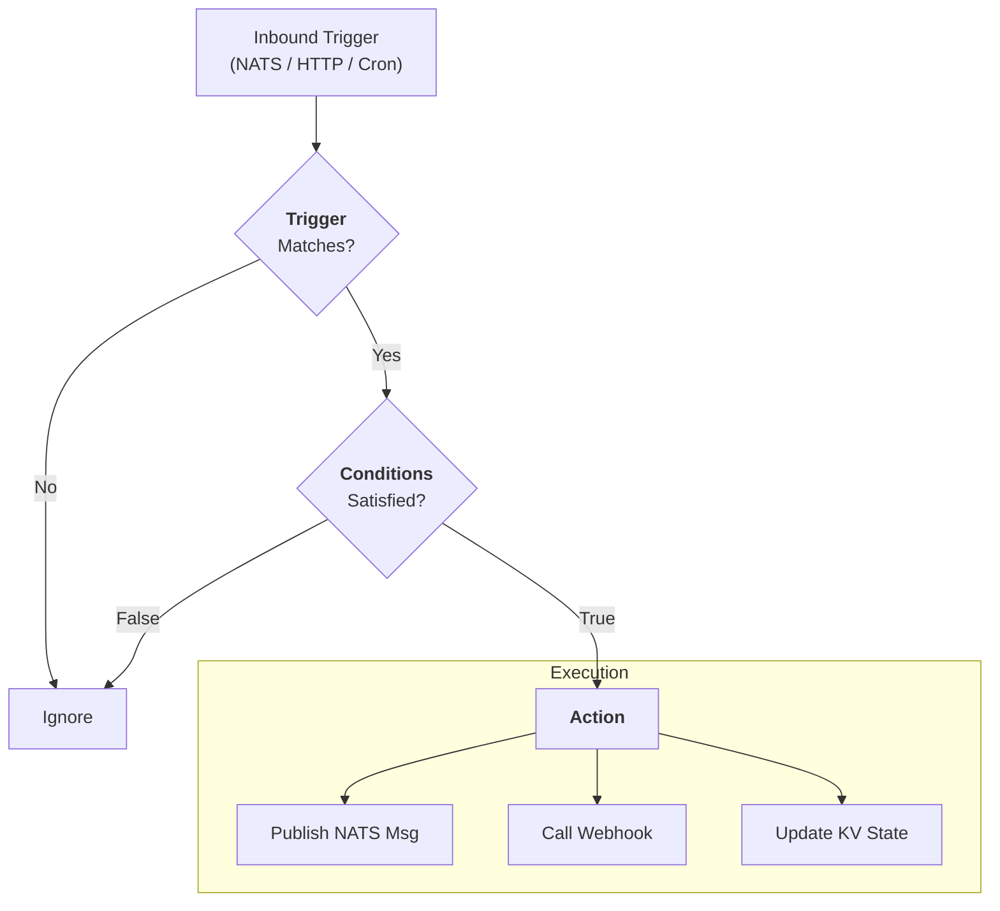

# Automation

The **rule engine** is Layer 1 of Stone-Age.io: declarative event logic on top
of NATS, with no state between messages.

This page covers the engine's three features (router, gateway, scheduler), the
patterns that use NATS KV for state, the patterns that combine the engine with
the platform's other parts, and when to use a stream processor instead. See [Platform Layers](./platform-layers.md) for the layer model.



---

## 1. The Rule Engine: One Binary, Three Features

The rule engine (`rule-router`) is a **separate binary** that runs beside NATS,
like the Agent but on the central side. It is **not** part of the Control Plane
binary. It connects to NATS as a client and does all its work over NATS
subjects and KV buckets.

You can run the rule engine:

- **Centrally** beside your main NATS cluster. This is the usual case.
- **At the edge** beside a NATS leaf node at a customer site, so local rules
  keep running during WAN outages.
- **Both.** For example, central rules for aggregation and cross-site alerts,
  and edge rules for site-local reactions.

The engine keeps no state between messages and scales horizontally. To get more
throughput, run another instance on the same NATS cluster. Durable state is in
NATS KV, not in the engine. The one exception: **throttle windows** (§5) are in
each instance's memory. Two instances keep two sets of windows. A restart
clears them all. A rule reload clears the leading-edge windows only: a trailing
value that is waiting still fires when its window closes.

How instances share work depends on the trigger's transport. The default
JetStream trigger is a durable consumer named from the subject and the
configured consumer prefix, so instances with the same prefix share the consumer
and split the messages. A `mode: core` trigger is a plain subscription. Without
a `queue` group, **every instance gets every message** and fires the rule once
each.

The binary has three features. They share the YAML rule syntax, the KV buckets
and the evaluation engine. They differ in the **trigger** (where events come
from) and the available **actions**.

| Feature | Trigger | Typical Actions | Default? |
|---|---|---|---|
| **Router** | NATS subject | Publish to NATS; call HTTP | ✅ Default |
| **Gateway** | HTTP request (inbound); NATS subject (outbound) | Publish to NATS (inbound); call HTTP with retry (outbound) | Opt-in |
| **Scheduler** | Cron expression | Publish to NATS; call HTTP with retry | Opt-in |

Turn features on in the binary's config file or with environment variables
(for example `RR_FEATURES_GATEWAY=true`). You can run any combination in one
process, or split them across processes. See the
[rule-router documentation](./vendor/rule-router/README.md) for each
feature's configuration.

### The TCA Pattern

Every rule has the same **Trigger, Condition, Action** structure:

1. **Trigger:** an event arrives (a NATS message, an HTTP request or a cron
   tick).
2. **Condition:** the engine tests the event against the conditions, if any.
3. **Action:** if the conditions pass, the engine runs the action.

### Key Engine Properties

- **No state between messages:** each evaluation is independent. The engine
  holds no durable state, apart from in-memory throttle windows. Rules read and
  write state in NATS KV.
- **One action per rule:** "write the state *and* notify" is two rules, or a
  rule whose output triggers the next one.
- **Fast:** rules evaluate in microseconds, so one instance handles thousands
  of messages per second. Cached KV lookups take under a microsecond, so a
  condition with several lookups stays fast.
- **YAML:** rules are YAML files, or entries in a NATS KV bucket that the engine
  reloads on change (see the rule-router docs).
- **Variables:** `{field_name}` reads message data. `{@system_var}` reads
  context, such as `{@timestamp()}`, `{@subject}` or a `{@kv.bucket.key}` lookup.

For the full YAML syntax, variables and functions, `forEach` over arrays,
payload modes (`passthrough`, `merge`) and signature verification, see the
[rule-router documentation](./vendor/rule-router/README.md). This page
describes the rule-router version in
[Operations §6.1](./operations.md#61-the-versions-these-docs-describe).

---

## 2. Feature: Router (NATS to NATS)

The router is the default feature. It reads NATS subjects, tests conditions on
message payloads and metadata, and publishes to NATS or calls HTTP.

### Example: Temperature Threshold with Enrichment

```yaml
- trigger:
    nats:
      subject: "telemetry.*.temp"
  conditions:
    operator: and
    items:
      - field: "{value}"
        operator: gt
        value: 45
  action:
    nats:
      subject: "alerts.{@subject.1}.high_temp"
      payload: |
        {
          "device": "{@subject.1}",
          "value": {value},
          "location": "{@kv.devices.{@subject.1}:location}",
          "timestamp": "{@timestamp()}"
        }
```

This rule fires when a message on `telemetry.*.temp` has a `value` over 45. It
publishes an alert with the device's location from a KV bucket. `{@subject.1}`
is the subject token that the wildcard matched.

**A NATS trigger is a JetStream consumer by default**, so a stream must already
cover `telemetry.*.temp`. If none does, the engine rejects the rule at load
("no stream found for trigger subject"). Actions also publish to JetStream and
wait for an ack by default, so `alerts.>` needs a stream too, or every fire logs
an ack timeout. For subjects you do not stream (heartbeats, or high-rate
telemetry where a lost message does not matter), set `mode: core` on the trigger
or the action. Core mode is at-most-once, needs no stream, and takes an optional
`queue` group.

A NATS trigger can also serve **request/reply**. `reply: true` subscribes over
core NATS and answers each request with a `respond` action.

### Use the router for

- Routing and filtering: splitting a stream into specific subjects.
- Enrichment: adding KV context to sparse events.
- Translation: reshaping payloads before forwarding.
- Stateful patterns such as alarm stacking and presence tracking (§5). For
  debounce and rate limiting, use the built-in `throttle` (§5).

---

## 3. Feature: Gateway (HTTP and NATS)

The gateway connects HTTP and NATS in both directions, with the same engine.

### Inbound: Webhook to NATS

Devices or services that cannot use NATS send HTTP POSTs to a configured path.
The gateway evaluates rules on the request and publishes the result to NATS. By
default it replies at once with `200` and processes the request asynchronously.
A rule with a `respond` action, or a NATS action with `request: true`, answers
synchronously instead.

**Put signature verification on every endpoint the internet can reach.**
Without it, anyone who learns the path can publish into your bus. An `hmac`
block covers GitHub, Shopify and most generic webhooks, and `scheme: stripe`,
`slack` or `standardwebhooks` covers providers that sign a timestamp. See
[Verifying webhook signatures](./vendor/rule-router/docs/02-gateway.md#verifying-webhook-signatures-hmac).

```yaml
- trigger:
    http:
      path: "/webhooks/github"
      method: "POST"
      hmac:
        header: "X-Hub-Signature-256"
        secret: "${GITHUB_WEBHOOK_SECRET}"
        algorithm: "sha256"
        encoding: "hex"
        prefix: "sha256="
  conditions:
    operator: and
    items:
      - field: "{@header.X-GitHub-Event}"
        operator: eq
        value: "push"
  action:
    nats:
      subject: "scm.github.push.{repository.name}"
      payload: |
        {
          "repo": "{repository.full_name}",
          "branch": "{ref}",
          "pusher": "{pusher.name}",
          "commits": {commits}
        }
```

The GitHub webhook becomes a NATS message under `scm.github.push`. Router and
scheduler rules can react to `scm.github.push.>` without knowing it came from
HTTP.

### Outbound: NATS to HTTP

The gateway also listens on NATS subjects and turns matching messages into HTTP
calls, such as every message on `alerts.>` into a Slack notification. A `retry`
block retries with exponential backoff, so a short outage of the third-party API
does not lose messages. See
[Outbound: NATS → HTTP](./vendor/rule-router/docs/02-gateway.md#outbound-nats-http).

### Use the gateway for

- **Inbound:** webhooks from GitHub, Jira, Stripe, building management systems,
  or any device that speaks HTTP but not NATS.
- **Outbound:** alerts or events to Slack, Microsoft Teams, Ntfy, PagerDuty or
  any REST API.
- Two-way integration with services that have no NATS client library.

---

## 4. Feature: Scheduler (Cron to NATS/HTTP)

The scheduler fires on cron expressions, not on messages. Use it for periodic
publishes: batch commands, reports, cache warming, or fan-out over a list in KV.
An expression has five fields, or six with a leading seconds field for
intervals under a minute.

### Example: Weekday Morning Door Unlock Fan-Out

```yaml
- trigger:
    schedule:
      cron: "0 8 * * 1-5"
      timezone: "America/New_York"
  action:
    nats:
      forEach: "{@kv.config.door_list}"
      subject: "access.door.{id}.command"
      payload: |
        {
          "command": "unlock",
          "zone": "{zone}",
          "source": "rule-scheduler",
          "id": "{@uuid7()}"
        }
```

At 8:00 AM Eastern every weekday, this rule reads a door list from the
`config.door_list` KV key and publishes one unlock command per door. To add or
remove doors, update the KV entry. You do not change the rule or restart
anything.

The subjects here are illustrative, for door hardware driven by its own
controller. The [Access Control](./vendor/access-control/README.md) app does
not take commands like this: its controllers run scheduled postures themselves,
and operator commands use its own subjects
([Wire Protocol](./vendor/access-control/docs/protocol.md)).

### Scheduler Semantics

A scheduled rule has **no incoming message**, so its conditions can use time
variables, KV lookups and template functions, but not message fields or headers.
With no `timezone`, the engine uses system local time. NATS and HTTP actions
both work. See [Scheduler](./vendor/rule-router/docs/03-scheduler.md) for
sub-minute schedules, overlapping fires and polling an API on a schedule.

### Use the scheduler for

- Periodic batch work: nightly reports, weekly summaries, monthly cleanup.
- KV-driven fan-out: "do X for every entry in this KV list".
- Cache warming or precomputation that publishes to NATS.
- Replacing separate cron daemons, with the same rule syntax as your other
  automation.

---

## 5. Stateful Patterns via KV

The engine keeps no state between messages, but rules can read and write NATS
KV. This gives you stateful behavior with no separate state store.

### Stateful Alarms (KV Stacking)

A sensor that flickers around a threshold can send 100 alerts. To prevent this,
keep the alarm state in a KV bucket:

1. **Threshold hit:** a rule fires on the reading only if no alarm is active:
   an `or` group of `{@kv.alarms.device_01.high_temp}` with `not_exists` (no
   alarm yet) and `{@kv.alarms.device_01.high_temp:state}` `eq` `cleared`.
   Only `not_exists` matches a missing key. `neq` `active` is `false` on a
   missing key, so it would never raise the first alarm.
2. **Write state:** the rule's action writes the alarm state. A write is a
   normal publish to the bucket's subject, `$KV.alarms.device_01.high_temp`,
   with the value as the body.
3. **Notify:** a rule has one action, so a second rule sends the notification.
   It triggers on the write (`$KV.alarms.>`) or on the same threshold
   condition.
4. **Deduplication:** once the key holds an active alarm, neither condition
   passes. The administrator was already notified, and the rules do nothing.
5. **Auto-clear:** when the temperature is normal again, another rule
   overwrites the key with a cleared state. A recovery notification can trigger
   on that write in the same way.

**The rules keep no state. The KV bucket holds it.**

### Other KV-Backed Patterns

- **Presence tracking with a TTL.** Each relevant event refreshes a KV key with a
  short TTL. When the key expires, that is the "gone" event. Use it for
  occupancy or heartbeat monitoring.
- **Deduplication.** A KV key per event ID stops duplicates across restarts or
  replays.

### Detecting silence

A rule runs when a message arrives, so on its own it cannot notice that
messages have *stopped*. A TTL key catches a sender that goes quiet, but not one
that never reports at all, because a key that was never written never expires.

For liveness across a fleet, run the [Watchdog](./vendor/services/docs/watchdog.md).
It is a small service in the tenant's account that watches the subjects you
name in a KV bucket, and writes each target's `pending`, `up` or `down` state
to another KV bucket. A rule on `$KV.watchdog_state.>` then sends the
notification, the same way the alarm pattern above triggers on `$KV.alarms.>`.
§6 builds escalation, silences and inactivity timers on top of it.

### Throttle and debounce are built in

Rate limiting and debounce do **not** use KV, because rule templates have no
arithmetic and cannot increment a counter. Each rule takes a `throttle` block
with a `window` and an optional `key` for one window per device or room.
`mode: leading` (the default) fires the first match, for alerts. `mode: trailing`
fires the last one when the window closes, for real debounce.

Put the throttle on the **action**, not the trigger. A trigger throttle skips
evaluation, so a normal reading can use up the window and the engine never
evaluates the alarming reading after it. The windows are in each instance's
memory (§1), so a restart resets them. If suppression must survive a restart,
gate the rule on a KV key with `not_exists`, have its action write that key, and
let the bucket's TTL expire it. See
[Throttle](./vendor/rule-router/docs/01-core-concepts.md#4-throttle) for the
modes and reload behaviour in full.

---

## 6. Patterns Built From Existing Parts

Some needs look like they call for a new service, but the parts you already run
cover them. Each pattern below combines the rule engine with one other part:
the [Watchdog](./vendor/services/docs/watchdog.md), the
[Helpdesk](./vendor/helpdesk/README.md), a KV bucket, or NATS message
scheduling. Reach for a new service only when none of them fits.

| Need | Built from |
| :--- | :--- |
| Escalation and acknowledgement | Watchdog or alarm → rule → Helpdesk ticket |
| Silencing alerts during maintenance | A KV key per check, with a TTL, read by the alert rule |
| "Do this after N minutes of inactivity" | A Watchdog check, plus a rule on its state |
| "Do this at a time the message names" | NATS message scheduling, set by a rule |

### Escalation and Acknowledgement

A notification is easy to miss. A **ticket** has an owner, a status and a
history, and stays open until someone resolves it. The Helpdesk already takes
machine-generated tickets over NATS, so a rule can turn a Watchdog `down`, or
any alarm, into one:

```yaml
- trigger:
    nats:
      subject: "$KV.watchdog_state.>"
  conditions:
    operator: and
    items:
      - field: "{state}"
        operator: eq
        value: "down"
  action:
    nats:
      subject: "helpdesk.tickets.create"
      mode: core
      payload: |
        {
          "title": "{target} stopped reporting ({check})",
          "body": "Down since {since}. Last message: {last_seen}.",
          "priority": "high",
          "dedupe_key": "watchdog-{check}-{target}",
          "thing": "{target}"
        }
```

- **`dedupe_key` stops ticket storms.** While a ticket with the same key is
  open, a repeat only increases that ticket's repeat count. Once the ticket is
  resolved, the next `down` opens a new one. A flapping target is one ticket,
  and a failure that returns after the fix is a new ticket.
- **`mode: core` is required.** The stream that stores tickets is in the
  operator's hub account, reached through the platform's export and import. No
  stream in the tenant's account covers the subject, so a JetStream action
  would wait for an ack that never comes and log an ack timeout on every fire.
- **The ticket does not close itself.** Helpdesk takes only the `create` verb
  today, so a target that comes back `up` does not resolve its ticket. Whoever
  works the ticket resolves it. A second rule can still send an `up`
  notification.
- **`thing` is free text. `thing_code` links the ticket to inventory.** The
  Helpdesk stores `thing` as a note and resolves nothing from it. If your
  targets are Thing codes, also add `"thing_code": "{target}"`, and the ticket
  is joined to the Thing for reporting. See the Helpdesk [wire protocol](./vendor/helpdesk/docs/protocol.md#2-nats-ticket-events).

Escalation then happens where people work: the ticket's priority, assignee and
the Helpdesk's own notifications. The rule's only job is to open it once.

### Silencing Alerts During Maintenance

Planned work makes devices go quiet on purpose. Put a key in a `silences`
bucket for each check being worked on, and have the alert rule skip any check
that has one:

```bash
# Once: a bucket that allows a TTL on each key
nats kv add silences
nats kv edit silences --marker-ttl 1m

# Silence the "gateways" check for two hours
nats kv create silences gateways '{"reason": "firmware upgrade, ticket #42"}' --ttl 2h
```

```yaml
  conditions:
    operator: and
    items:
      - field: "{state}"
        operator: eq
        value: "down"
      - field: "{@kv.silences.{check}}"
        operator: not_exists
```

- **The silence ends by itself.** The key's TTL removes it, so nobody has to
  remember to turn alerts back on. To end it early, `nats kv del silences gateways`.
- **The TTL is fixed when the key is created.** `put` and `update` remove it, so
  to extend a silence, delete the key and create it again.
- **Only alerts are silenced, not detection.** The Watchdog still records every
  state change while the silence is on, so the state is correct the moment it
  ends.
- **The value says why,** so the next person who looks knows. The rule only
  checks that the key exists.

### Inactivity Timers

"Turn the lights off after 10 minutes with no motion" is the Watchdog's job
under another name: a target that stops sending messages. Point a check at the
motion subject, and turn the `down` state into a command:

```bash
nats kv put watchdog_checks rooms '{
  "subject": "room.*.motion",
  "target_token": 1,
  "timeout": "10m"
}'
```

```yaml
- trigger:
    nats:
      subject: "$KV.watchdog_state.rooms.*"
  conditions:
    operator: and
    items:
      - field: "{state}"
        operator: eq
        value: "down"
  action:
    nats:
      subject: "room.{target}.lights"
      payload: '{"on": false}'
```

- **Turn the lights on from the motion itself,** with an ordinary rule on
  `room.*.motion`. The Watchdog only marks the room `up` on the next
  evaluation, and only writes when the state changes.
- **The timer is coarse.** A room goes `down` up to one evaluation interval
  (10s by default) after the timeout. The shortest timeout is three evaluation
  intervals, 30s by default. For a door held open for 15 seconds, use
  something that runs at the door, such as the Access Control controller.
- **A room is learned from its first motion.** A room that never reports isn't
  tracked unless it's listed in `expected`.

### Actions at a Time the Message Names

Sometimes the time to act is in the message: a booking ends at 17:00, a
temporary credential expires at midnight. NATS message scheduling (nats-server
2.12 and later) holds a message in a stream and publishes it at that time. A
rule sets the schedule with two headers:

```yaml
- trigger:
    nats:
      subject: "bookings.*.created"
  action:
    nats:
      subject: "schedules.booking.{@subject.1}"
      headers:
        Nats-Schedule: "@at {ends_at}"
        Nats-Schedule-Target: "bookings.{@subject.1}.ended"
      payload: '{"booking": "{@subject.1}"}'
```

At `ends_at`, the stream publishes the payload to `bookings.{id}.ended`, where
another rule acts on it.

- **The stream needs scheduling turned on.** Create a stream with
  `allow_msg_schedules: true` whose subjects cover both the schedule subjects
  (`schedules.>`) and the targets (`bookings.*.ended`). Scheduling can't be
  turned off on a stream once it's on.
- **Each schedule has its own subject.** Publishing again to the same schedule
  subject replaces the earlier schedule, which is how a rule extends a booking.
- **To cancel,** publish any message to another subject in the stream with the
  headers `Nats-Schedule-Next: purge` and `Nats-Scheduler: schedules.booking.{id}`.
  The schedule is removed only if that publish succeeds.
- **The time must be in the message, in RFC 3339.** Templates have no arithmetic,
  so a rule can't compute "now plus 10 minutes". For a delay relative to the
  last message, use an [inactivity timer](#inactivity-timers). For a fixed time
  of day, use the [scheduler](#4-feature-scheduler-cron-to-natshttp). Otherwise,
  have the publisher put the time in the payload.
- **A time in the past fires immediately,** for example after a long outage.

---

## 7. Rule-Writing Best Practices

- **Use specific subjects.** Do not trigger on `>`. Use narrow subjects such as
  `telemetry.*.temp`.
- **Keep JSON flat.** The engine reads nested fields (`{user.profile.email}`),
  but flat structures are easier to read and faster to evaluate.
- **Use KV for context.** Do not repeat static data such as "unit location" in
  every message. Store it in KV and add it with a `{@kv.lookup}`.
- **Keep state in KV, not in rules.** If a rule must remember something across
  messages, use a KV key. The one built-in exception is `throttle`.
- **Name subjects consistently.** Rules, stream processors and Telegraf all use
  the same subjects. Choose a hierarchy and keep it.

---

## 8. When to Use Something Else

Anything with a **time window**, a **join** of two streams, **retractable**
results, **SQL** over streams or **complex event processing** belongs in a
stream processor that runs beside your rules on the same bus. Logic specific to
your domain (a physics model, ML inference, your own libraries) belongs in a
small service that reads from and publishes to NATS. The
[services repository](./vendor/services/README.md) holds the ones useful to
every tenant, such as the Watchdog. [Stream Processing](./stream-processing.md)
covers both and says when each fits.

---

## 9. What the Rule Engine Does Well

The rule engine fits any problem of the form "when X happens (on subject A, by
webhook B or at cron time T), check Y (with KV state if needed), do Z (publish,
HTTP call or KV update)". That covers most operational event logic: routing,
enrichment, alarms, webhooks, scheduled fan-out, debounce and rate limiting.

It also fits your application's own access control. For example, one rule with
KV lookups can go from a badge credential to a user, to permissions, to an
unlock decision. This is not the platform's own authorization, which only
PocketBase API rules enforce (see [Authorization & Roles](./authorization.md)).

Rules run in microseconds, are YAML you can keep in version control, and need
only the one binary to run.
