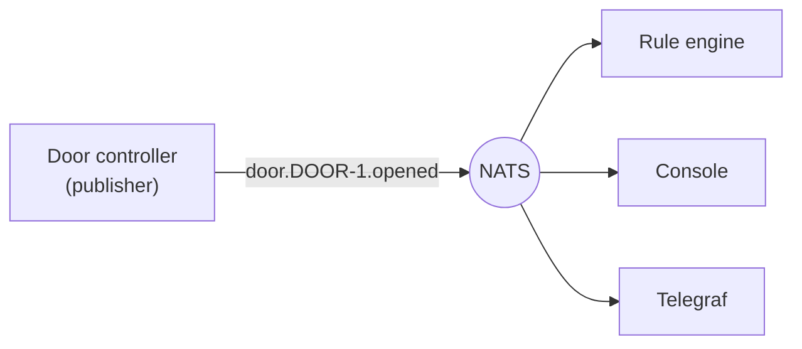
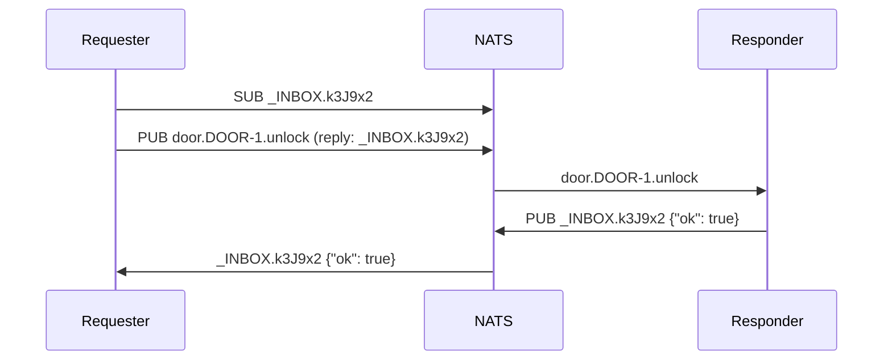

# Messaging

Every Stone-Age.io component talks over one message bus, NATS. This page
explains the messaging model of that bus. For the subject names the platform
uses, see [Connectivity §1](../connectivity.md#1-nats). For the full detail,
see the [NATS documentation](https://docs.nats.io/nats-concepts/overview).

---

## 1. Publish and subscribe

With HTTP, a client sends a request to a server that it knows. On a message
bus, a **publisher** sends a message to a name. Every **subscriber** that
listens on that name receives a copy. The name is the **subject**.



This model has three results:

- **The publisher does not know the subscribers.** You can add a consumer, such
  as a dashboard or an alarm rule, with no change to the device.
- **Each subscriber gets its own copy.** This is called *fan-out*. One message
  from one door reaches the rule engine, the console and Telegraf.
- **No subscriber means no delivery.** Core NATS does not store messages. If
  nothing listens when the door publishes, the message is lost. §5 explains
  how to store messages.

A NATS message has four parts:

| Part | What it is |
| :--- | :--- |
| **Subject** | The name that the message goes to. Required. |
| **Reply subject** | Optional. The subject that the receiver sends its answer to (§4). |
| **Headers** | Optional key-value pairs, as in HTTP. |
| **Payload** | The data, as bytes. NATS does not read or check it. |

NATS accepts a payload in any format. The platform's components use JSON. The
server refuses a payload larger than its `max_payload`, which is 1 MB by
default. A [NATS role](../connectivity.md#core-pubsub-subject-namespacing) can
set a lower limit.

---

## 2. Subjects

A subject is a string of **tokens**, separated by dots:

```
camera.CA-9KD-4PX.motion
```

- Subjects are case-sensitive. `Camera.CA-1` and `camera.CA-1` are two
  different subjects.
- A token cannot be empty, and it cannot contain a space.
- NATS accepts some other characters, but the NATS documentation recommends
  letters, digits, `-` and `_` only.

### Wildcards

A subscriber can use a wildcard to match many subjects:

| Wildcard | Matches | Example | Matches | Does not match |
| :--- | :--- | :--- | :--- | :--- |
| `*` | Exactly one token | `camera.*.motion` | `camera.CA-1.motion` | `camera.CA-1.zone2.motion` |
| `>` | One or more tokens, at the end only | `camera.>` | `camera.CA-1.motion`, `camera.CA-1.zone2.motion` | `camera` |

- **A publisher never uses a wildcard.** It always sends to one full subject.
  Wildcards are for subscriptions, stream filters and permission lists.
- **`>` must be the last token.** `camera.>.motion` is not a valid subject.

### Order tokens from general to specific

Put the broad token first and the narrow token last. Then a wildcard at the
end selects a group. `camera.>` selects every camera, and `camera.CA-1.>`
selects one camera. A wildcard in the middle, such as `*.CA-1.>`, also works.
But it is harder to read in a permission list or a stream filter.

The platform's default subject follows this rule:
`{thing_type_code}.{thing}.{operation_suffix}`. See
[Connectivity §1](../connectivity.md#core-pubsub-subject-namespacing) and
[ADR 0003](../decisions/0003-human-friendly-codes-and-default-subject.md).

---

## 3. Queue groups

Normal subscribers each get a copy of every message. Subscribers that join the
same **queue group** share the messages instead. NATS gives each message to
one member of the group.

Use a queue group to run several copies of one service:

- **Load:** each message is processed once, by one member.
- **Scale:** start a member to add capacity. Stop a member to remove it. The
  server needs no change.
- **Redundancy:** when a member stops, the other members receive its share.

A queue group does not store messages. If every member is down, NATS
delivers the messages to nobody, as with any other core NATS subscription.

---

## 4. Request and reply

Some messages need an answer, such as "read this sensor now" or "unlock this
door". NATS builds request and reply from normal publish and subscribe:

1. The requester makes a unique subject for the answer, called its **inbox**,
   such as `_INBOX.k3J9x2`. It subscribes to the inbox.
2. The requester publishes the request, with the inbox as the reply subject.
3. The responder receives the request and publishes its answer to the reply
   subject.
4. The requester receives the answer, or it stops waiting after a timeout.



If no subscriber listens on the request subject, the server tells the
requester at once with a "no responders" status. The requester does not wait
for the full timeout. Responders in one queue group share the requests, so
request and reply also spreads load.

::: warning A request needs permissions in both directions
The requester publishes the request, but it must also **subscribe** to
`_INBOX.>` to receive the answer. The responder must be allowed to
**publish** the answer. In Stone-Age.io, the platform adds neither permission
for you. A request that times out with a responder online usually means that
one of these permissions is missing. See
[Connectivity §1](../connectivity.md#core-pubsub-subject-namespacing).
:::

### Services

A **NATS micro service** is a request and reply service that follows a NATS
convention. It answers requests on its own subjects, and it also answers
discovery requests on `$SRV.>` subjects. A tool such as `nats micro list` can
then find every running service and its endpoints. The Agent, the helpdesk,
access-control and rule-router are micro services.

---

## 5. What core NATS does not do

Core NATS delivers each message **at most once**. It keeps a message only long
enough to pass it to the subscribers that listen at that moment.

- A subscriber that is offline misses the message.
- A subscriber that cannot keep up with the messages can be disconnected by
  the server.
- No client can read a message again later.

**JetStream** is the persistence layer inside the NATS server. It adds three
things:

| Feature | What it does | Platform use |
| :--- | :--- | :--- |
| **Stream** | Stores the messages published to chosen subjects. | History for dashboards and for the TSDB writer. |
| **Consumer** | Reads a stream from a position, and remembers how far it read. With acknowledgements, this gives at-least-once delivery. | Telegraf reads telemetry with no loss after an outage. |
| **KV bucket** | Keeps the latest value for each key. | The digital twin, and rule state. |

The publisher does not change. A device publishes to a subject as usual, and a
stream whose filter covers that subject stores the message.

::: warning A subscription does not read from a stream
A plain subscription is core NATS, even when a stream stores the same
subject. It receives only the messages published while it is connected. To
read stored messages, a client must read through a JetStream consumer. See
[Persistence](./persistence.md).
:::

---

## 6. Accounts keep tenants apart

Every connection belongs to one NATS **Account**. Each account has its own
subjects, streams and KV buckets. Two accounts can both use `camera.>`, and
neither sees the messages of the other. In Stone-Age.io, each Organization has
one account.

To share chosen subjects between two accounts, the source account **exports**
them and the other account **imports** them. See
[Connectivity §1](../connectivity.md#cross-account-subject-sharing-imports-exports).
[NATS Security](./nats-security.md) explains how the server enforces the
account boundary.

---

## 7. If you know MQTT

The NATS server can accept MQTT clients. It maps MQTT topics to NATS subjects,
so MQTT devices and NATS clients use the same bus.

| MQTT | NATS | Note |
| :--- | :--- | :--- |
| Broker | Server | |
| Topic `site/door1/opened` | Subject `site.door1.opened` | The server changes `/` to `.`. |
| `+` | `*` | Matches one level or token. |
| `#` | `>` | Matches all remaining levels or tokens. |
| QoS 0 | Core NATS publish | At most once. |
| QoS 1 | JetStream | At least once. |
| Retained message | The nearest match is a KV key | Both keep the latest value. |
| No equivalent in MQTT 3.1.1 | Request and reply (§4) | |
| No equivalent in MQTT 3.1.1 | Queue groups (§3) | |

- **The server supports MQTT 3.1.1.**
- **MQTT needs JetStream.** Turn on JetStream on each server, cluster or leaf
  node that accepts MQTT.
- **MQTT clients use the same identity as NATS clients.** A client sends its
  user JWT as a bearer token, and the same subject permissions apply. See
  [Architecture §6](../architecture.md#mqtt).

---

## 8. Where to Go Next

- How credentials and permissions work: [NATS Security](./nats-security.md)
- Streams, consumers and KV: [Persistence](./persistence.md)
- How to shape subjects and payloads: [Message Design](./message-design.md)
- The platform's subject layout, streams and KV:
  [Connectivity](../connectivity.md)
- Subjects that a Thing Type defines: [Thing Types](../thing-types.md)
- Rules that react to messages: [Automation](../automation.md)
- Sites that keep working offline: [Leaf Nodes](../leaf-nodes.md)
