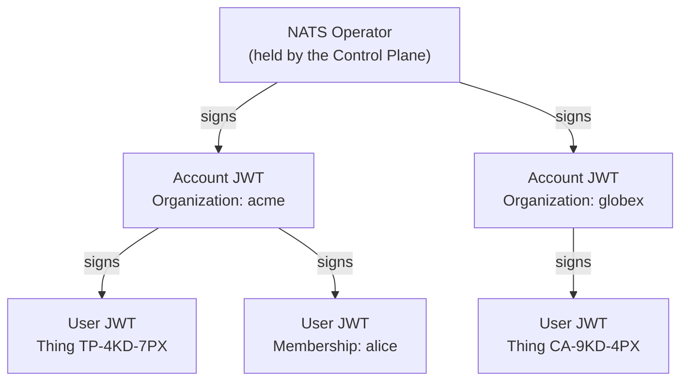

# NATS Security

NATS can check each connection with public-key cryptography instead of
passwords. In this mode, the NATS server stores no user secret. Stone-Age.io
uses this mode for every organization. This page explains the parts: key
pairs, JWTs, the trust chain, permissions and revocation. For the full detail,
see [JWT authentication](https://docs.nats.io/running-a-nats-service/configuration/securing_nats/auth_intro/jwt)
in the NATS documentation.

---

## 1. Key pairs (nkeys)

An **nkey** is an Ed25519 key pair, written in a NATS text format. It has two
halves:

| Half | Starts with | Who holds it |
| :--- | :--- | :--- |
| **Public key** | `O`, `A` or `U`, for Operator, Account or User | Anyone. It goes into JWTs and server config. |
| **Seed** (the private key) | `SO`, `SA` or `SU` | Only the owner. It signs data. Whoever has the seed *is* that identity. |

The first letter shows the role. `UDXU4R…` is the public key of a user, and
`SUAM…` is the seed of a user. If you find a string that starts with `S` in a
log, a ticket or a chat, treat it as a leaked secret.

---

## 2. JWTs

A **JSON Web Token** (JWT) is a small JSON document with a signature. It has
three parts, separated by dots: a header, a payload of **claims**, and a
signature. Each part is base64url text.

This is the payload of a user JWT that Stone-Age.io signs, decoded and
shortened:

```json
{
  "iss": "AB7K…",
  "sub": "UDXU4R…",
  "name": "TP-4KD-7PX",
  "iat": 1761264000,
  "nats": {
    "issuer_account": "ACZQ…",
    "pub": { "allow": ["temp_sensor.TP-4KD-7PX.>"] },
    "sub": { "allow": ["_INBOX.>"] },
    "type": "user",
    "version": 2
  }
}
```

| Claim | What it means |
| :--- | :--- |
| `iss` | The issuer: the public key that signed this JWT. Here it is a signing key of the account (§3). |
| `sub` | The public key that this JWT describes. Here it is the user. |
| `iat` | When the JWT was issued, in Unix seconds. Revocation compares against it (§6). |
| `nats.issuer_account` | The account that owns the signing key in `iss`. |
| `nats.pub`, `nats.sub` | Publish and subscribe permissions (§5). |

Three facts about every JWT:

- **Anyone can read it.** Base64url is an encoding, not encryption. Do not put
  a secret in a claim.
- **Nobody can change it without the issuer's seed.** A change breaks the
  signature. So a user cannot edit its own permissions.
- **A JWT alone does not connect.** The JWT is public. The client must also
  prove that it holds the seed (§4).

::: note `sub` has two meanings, and neither one is a message subject
At the top level of a JWT, `sub` is the standard JWT *subject* claim: the
identity that the token describes. Inside `nats`, `sub` holds the
*subscribe* permissions. Neither one is a NATS message subject.
:::

---

## 3. The trust chain

NATS uses three levels of identity. Each level signs the JWTs of the level
below it.



| Level | Signed by | What it holds | In Stone-Age.io |
| :--- | :--- | :--- | :--- |
| **Operator** | Itself | The root of trust. Each server is configured to trust its public key. | The **NATS Operator**. One for each deployment. The Control Plane holds its seed. |
| **Account** | The Operator | The tenant boundary: its subjects, streams, KV buckets, limits, signing keys and revocation list. | One for each Organization. |
| **User** | The account, or one of its signing keys | One identity that connects: its permissions and limits. | One for each Thing with a NATS identity, and one for each Membership that links one. |

The NATS Operator is a key. It is not the Platform Operator, who is a person.
See the [Glossary](../overview.md#glossary).

**The server never needs a user JWT in advance.** It needs the Operator's
public key and the account JWTs. Each client brings its own user JWT. So the
Control Plane can create a user with no change to any server. When an account
JWT changes, the Control Plane sends the new JWT to the servers. A site's leaf
node keeps its own copy, which its Agent refreshes. See
[Architecture §5](../architecture.md#nats-security-nkeys-jwts) and
[Leaf Nodes §8.1](../leaf-nodes.md#81-what-reaches-a-site-and-when).

### Signing keys

An account can have extra key pairs, called **signing keys**. The account
signs user JWTs with a signing key instead of its own identity key. The
account JWT lists the signing keys that it trusts.

- **Add a key:** user JWTs signed by the other keys stay valid. Use this for
  routine rotation.
- **Remove a key:** every user JWT signed by that key stops working.

In Stone-Age.io, an Owner or Admin manages signing keys through a route. See
[Authorization §4.1](../authorization.md#41-account-signing-keys).

---

## 4. How a client connects

1. The client opens a connection. The server sends a random value, called a
   **nonce**.
2. The client signs the nonce with its seed. It sends the signature and its
   user JWT.
3. The server checks the signature against the public key in the user JWT.
   This proves that the client holds the seed.
4. The server checks that the account, or one of its signing keys, signed the
   user JWT. It checks that the Operator signed the account JWT.
5. The server checks the account's revocation list, and the JWT's expiry if it
   has one.
6. The server applies the permissions and limits in the user JWT to the
   connection.

The seed never leaves the client.

### The `.creds` file

A `.creds` file holds the two things that a client needs to connect: the user
JWT and the seed. NATS client libraries and the `nats` CLI read it directly.
**The file holds the seed, so it is a secret.**

In Stone-Age.io, the file is `nats_users.creds_file`. The console's download
button gives a user their own file. The Agent writes the file with `0600`
permissions. See [The Agent §2.1](../agent.md#21-why-the-upkeep-call-is-split-in-two)
and [Authorization §4](../authorization.md#4-the-row-scoped-credential-model).

---

## 5. Permissions

The user JWT carries the permissions. They are four lists of subject patterns:
publish allow, publish deny, subscribe allow and subscribe deny.

- **Deny wins.** With subscribe allow `camera.>` and subscribe deny
  `camera.*.config`, the user receives every camera subject except `config`.
- **Patterns use subject wildcards.** See
  [Messaging §2](./messaging.md#wildcards).
- **Response permissions** let a responder publish to the reply subject of a
  request that it received, with no `_INBOX.>` publish permission. See
  [Messaging §4](./messaging.md#4-request-and-reply).

In Stone-Age.io, a **NATS Role** is a reusable set of permissions. The platform
copies a role's lists, and the user's own overrides, into each user JWT that it
signs. So only Owners and Admins can write roles. See
[Connectivity §1](../connectivity.md#core-pubsub-subject-namespacing).

::: warning An empty allow list means everything in NATS, and nothing in Stone-Age.io
In plain NATS, a user JWT with no permissions can publish and subscribe to
every subject in its account. Stone-Age.io does the opposite. If the role and
the user together allow no subject in one direction, the JWT that the platform
signs denies everything in that direction. To allow everything, write `>`.
:::

---

## 6. Revocation and expiry

Nobody can remove a signature from a JWT. NATS gives two ways to stop one:

- **Expiry:** a JWT can carry an expiry time, `exp`. After that time, the
  server refuses it.
- **Revocation:** the account JWT holds a list of user public keys, each with a
  cutoff time. The server refuses each JWT for that key with an `iat` at or
  before the cutoff. A JWT issued *after* the cutoff works.

A revocation is a change to the account JWT. So it applies on each server when
that server has the new account JWT. The hub applies it at once. A site's leaf
node applies it at its next refresh.

The cutoff explains how Stone-Age.io handles credentials:

| Platform action | What changes in NATS | An old `.creds` file |
| :--- | :--- | :--- |
| **Rotate** or **Regenerate** | A new user JWT, for the same key pair. | Keeps working. It stops only when its JWT expires, if the JWT has an expiry. |
| **Revoke** | A new key pair. The old public key goes on the revocation list. | Refused. |
| **Suspend** (`active = false`, or deactivate the Thing) | The key goes on the revocation list. Nothing new is issued. | Refused. |
| **Re-enable** | A new user JWT, issued after the cutoff. | Still refused, because it was issued before the cutoff. |

::: danger Delete does not revoke
A deleted Thing's NATS credential keeps working. To take a device out of
service, deactivate it. See
[Authorization §4.2](../authorization.md#42-taking-a-device-out-of-service).
:::

---

## 7. Where to Go Next

- How messages move: [Messaging](./messaging.md)
- The platform's chain of trust and tenancy:
  [Architecture](../architecture.md#3-multi-tenancy-infrastructure-isolation)
- Who can read and write credentials: [Authorization](../authorization.md)
- How a device gets and renews its credential: [The Agent](../agent.md)
- What reaches a site, and when: [Leaf Nodes](../leaf-nodes.md#81-what-reaches-a-site-and-when)
