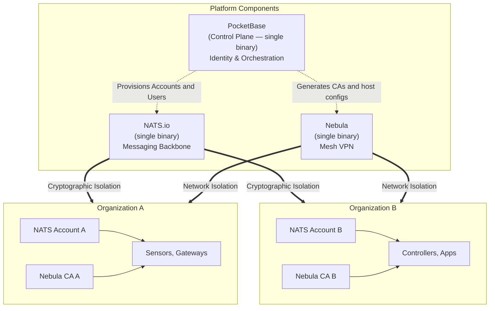

# Platform

**Make your equipment and your apps talk. Simple.**

Stone-Age.io is one open-source platform for everything from the door
controllers, sensors and machines on your sites to the cloud services you log
into separately today. Equipment connects if it speaks HTTP, MQTT or NATS. A
cloud service connects through the [rule engine](./automation.md), which
receives its webhooks and polls its API. You do not replace any of them.

The platform has one place to register equipment and the people who use it,
one real-time bus for what the equipment and the cloud services report, and
one encrypted network to reach the equipment. Each piece does one job, so you
can adopt only what you need now.

---

## Who It Is For

- **Managed service providers** who build their own branded RMM or IoT
  platform, with each customer in its own NATS account and Nebula CA.
- **System integrators** who deploy edge logic for smart buildings, industrial
  automation or fleet management.
- **Enterprise IT** teams who manage infrastructure across buildings, offices,
  factories or cloud providers and must keep their data under their own control.

## Your first page

| | Start here |
| :--- | :--- |
| **Just show me what it does** | [Getting Started](./getting-started.md). One container, then `demo-seed` gives you three tenants, a map, floor plans, signed identities and edge gateways. |
| **I run an integration business** | [Onboard a Tenant](./onboard-a-tenant.md) for a customer's first day, [Authorization & Roles](./authorization.md) for the tenancy model, then [Stone CLI](./stone-cli.md) to configure many sites from one workspace. |
| **I have a device to connect** | [Connect Your First Device](./first-device.md). A record, a signed identity and a first message on the bus. |
| **I run IT or operations for a facility** | [Connectivity](./connectivity.md) for how equipment reaches the bus, then [Observability](./observability.md) to send events to the stack you already run. |
| **I am evaluating the engineering** | [Architecture](./architecture.md), [API Reference](./api-reference.md), the [decision records](./decisions.md), and [Stability](./stability.md) for what 1.0 will keep stable. |

---

## The Problem It Solves

A private, multi-tenant IoT platform needs the same four parts every time: a
message broker, an overlay network, an identity and inventory store, and a place
for the logic. Each part is mature.

The difficulty is that "customer A cannot see customer B" must be true in all
four at once, and each one models tenancy differently. The broker has its own
tenant model, the VPN has another, the database has a `WHERE` clause, and the
rule engine usually has none. Isolation is only as strong as the weakest part.
Nothing in the stack tells you when the four drift apart, because each part does
exactly what its configuration says.

The usual answer is a hosted platform that owns all four. That works, but you
pay egress fees, you use proprietary APIs, and your data must leave the building.

::: note What this platform does *not* claim
It does not claim fewer moving parts. With every layer running, you have a
Control Plane, a broker, an overlay network, an Agent at each site, a rule
engine, a stream processor, a metrics agent and a time-series database. That is
eight component types.

The claim is about where the tenant boundary lives, and about starting small and
leaving easily.
:::

---

## What the Platform Commits To

**One tenant boundary, provisioned once.** Creating an Organization mints an
isolated NATS Account and a private Nebula CA in the same operation. A NATS
account is a closed subject namespace, so a tenant cannot reach outside it,
whatever its permissions say. A Nebula host cannot present a certificate that
another organization's CA trusts. There is no application filter to forget.

**Adopt one depth at a time.** Most deployments stay at [depth](#start-where-you-need-to)
2 or 3. You add the stream processor, the metrics agent and the TSDB when a
question needs them. Each new layer reads the subjects the previous one already
publishes, so nothing gets rewritten.

**Nothing is forked.** NATS and Nebula are upstream builds. The platform
provisions them and is otherwise an ordinary client of both. A site's leaf node
is upstream `nats-server` with a generated config, as its own process or inside
the Agent. Your data is in SQLite, your messages are on NATS, and your history
is in a TSDB you chose. To leave, keep all three and stop running the Control
Plane.

**No orchestrator.** Components find each other over NATS subjects. There is no
control loop, no sidecar, no service mesh and no Kubernetes requirement. Nebula
is a mesh *VPN*: a network layer, not a service mesh.

---

## What it is made of

Three open-source projects, each doing one job, plus our own components. There
is no proprietary protocol.

| Part | Job |
| :--- | :--- |
| **PocketBase** | Management: identity, inventory, organizations, locations, a SQLite database, a REST API and an admin UI, in one binary. When you create a Thing, it mints the credentials the Thing fetches on first boot. |
| **NATS.io** | Messaging: pub/sub with native MQTT, JetStream for persistence and replay, key-value buckets for live device state, and leaf nodes that keep a site running when its internet connection fails. |
| **Nebula** | Connectivity: a peer-to-peer mesh with NAT traversal, identity-based firewall rules and outbound-only connections. No port opens on an edge network. |
| **Stone-Age.io** | The console, [`rule-router`](./automation.md) for YAML automation across NATS, HTTP and cron, and an [agent](./agent.md) that reports on and controls one device. |

Other tools connect to the same bus. [Telegraf](./observability.md) sends
JetStream data to the time-series database you choose.
[Stream processors](./stream-processing.md) such as eKuiper (windowed
aggregations and anomaly detection) or Benthos (transforming and routing
events) publish their results back for the rules to act on.

### Protocols

| Protocol | How |
| :--- | :--- |
| **NATS** | Native |
| **MQTT** | Native, through JetStream |
| **HTTP** | Webhooks in and API calls out, through the [rule engine's gateway](./automation.md) |
| **WebSocket** | The browser's connection to the bus |

### Deployment

Each component is a single binary, and the smallest working deployment is one
process: `./stone-age init`, then `./stone-age serve --nats`
([Getting Started](./getting-started.md)). Add Nebula, `rule-router` and the
Agent when you need them, on bare metal, containers or VMs. A gateway can also
run one binary, the Agent, which can host the Nebula host and the leaf server
([The Agent](./agent.md)). The Control Plane runs on Linux, macOS and Windows.
The Agent and `rule-router` also run on FreeBSD. See
[Architecture §2](./architecture.md#2-component-topology) for every component,
when to add it, and how each one scales.

Self-hosted and hosted accounts run the same binaries, so you can move between
them without a rebuild. Where a feature applies only to hosted accounts, the
page says so.

"The platform", "the Control Plane", "the console" and "`stone`" are four
different things in these docs. See the [Glossary](./glossary.md).

---

## Start Where You Need To

You do not have to run everything. There are four depths, and you can stop at
any of them. Most deployments stay at depth 2 or 3.

### 1. An inventory

Things, Locations and their types, over the PocketBase REST API, with a
multi-tenant console. This depth has records only: no messaging, no mesh and no
contracts.

A Thing can exist with no NATS user and no Nebula host, and a Thing Type with
no operations only categorizes. When you add subjects later, you do not
rewrite the inventory.

> **Stop here if** you need a shared, permissioned, multi-tenant record of what you own and where it is. Examples are asset tracking, site surveys, and an equipment register that field techs edit from a phone.

### 2. Identities

Turn on identities. When you create an Organization, the platform provisions an
isolated NATS Account and a private Nebula CA. When you create a Thing, the
platform can mint its NATS user and its Nebula host certificate in the same
transaction. The tenant boundary is now cryptographic, not a `WHERE` clause.

The inventory record from depth 1 is now the identity your device
authenticates as. See [Inventory-as-Identity](./architecture.md#31-inventory-as-identity).

> **Stop here if** devices, services and people must reach each other securely across sites and NAT, and you write your own NATS consumers.

### 3. A contract layer

Declare what each participant says. A **Thing Type** has a subject prefix. Each
of its **operations** has a capability (`publish`, `subscribe`, `request` or
`reply`) and a subject suffix. Together they give the exact subject a Thing
uses, so a consumer can find a device's subjects from the records alone. See
[Thing Types](./thing-types.md).

> **Stop here if** more than one team or vendor writes code against your bus and the subject contract must be written down.

### 4. Everything that consumes it

The rule engine, the Agent, stream processors, Telegraf and your time-series
database. All of them are clients of the same bus. Add each one when you need it.

> **Stop here if** you are building an application, not only running infrastructure.

Each depth adds to the one before. The inventory record you create on day one
stays the same record. It gains identities, contracts and consumers.

---

## Key Features

| Feature | What it means |
| :--- | :--- |
| [Inventory-as-Identity](./architecture.md#31-inventory-as-identity) | A Thing is an auth record that can hold a NATS user and a Nebula host. "The camera in the lobby" is one row: inventory entry, login, messaging identity and mesh node. There is no separate device registry. |
| Infrastructure-as-Tenant | A Platform Operator creates an Organization, and the platform provisions its NATS Account and Nebula CA with it. Suspending the Organization withdraws the NATS Account and disconnects every device and browser in the tenant from the hub at once. Devices on a site's leaf node keep working locally ([Leaf Nodes §8.1](./leaf-nodes.md#81-what-reaches-a-site-and-when)). You can reverse a suspension. |
| [A contract layer](./thing-types.md) | Thing Types declare where a participant speaks (a subject prefix). Their operations declare what it does (`publish`, `subscribe`, `request`, `reply`). Payload shape is not described. |
| [Role-scoped access](./authorization.md) | Five roles per organization (`owner`, `admin`, `member`, `viewer`, `dashboard`) and a Platform Operator flag, enforced by PocketBase API rules. One hook refuses any relation into another Organization's records. Each user can read and rotate only their own credential. |
| Digital twins | Live device state is in NATS KV buckets and streams to the browser over WebSocket, with no database polling. At the edge, [KV bucket sync](./leaf-nodes.md#6-offline-autonomy-and-kv-bucket-sync) keeps a site's buckets current through a WAN outage. |
| [Activity feed and audit log](./authorization.md#5-two-histories-the-audit-log-and-the-activity-feed) | Every role can read the org's activity feed: actor, action, record and time, with no values. Only Platform Operators read the audit log, which records changed field names and, for collections with no credentials, the old and new values. |
| [Organization codes](./decisions/0002-organization-code-namespace.md) | An Organization's code is the one globally unique name. Everything under it is unique only within the Organization. Subjects, join keys and printed QR labels use codes, not ids. A label holds only the bare code, so a forged sticker cannot redirect anyone. |
| Outbound-only connections | Devices and Agents connect outward to NATS and Nebula. Edge nodes need no inbound ports. |
| [Declarative automation](./automation.md) | One rule engine handles NATS routing, webhooks in and out, and scheduled publishes, all as YAML rules. |
| [Your own storage](./observability.md) | Your time-series database reads long-term telemetry from NATS: VictoriaMetrics, InfluxDB, Prometheus, Postgres, or any other target Telegraf supports. |

---

## Planes and Layers

The platform has a **Control Plane** (management) and a **Data Plane** (runtime).
The Data Plane has four layers around NATS:

> **NATS is the bus. The rule engine is the reflexes. Stream processors are the thinking. Telegraf + TSDB is the memory.**

The layers and the depths answer different questions. The depths tell you how
much to adopt. The layers tell you which component solves a given problem. The
Control Plane is depth 1, and it sits beside the layers, not in them. See
[Platform Layers](./platform-layers.md).

---

## Philosophy

> "Complexity is the enemy of reliability."

Clear Go, plain Vue components and readable YAML over clever abstractions. The
[decision records](./decisions.md) say what was rejected and why, and the
constraints that are not obvious are written down next to the code that depends
on them.
