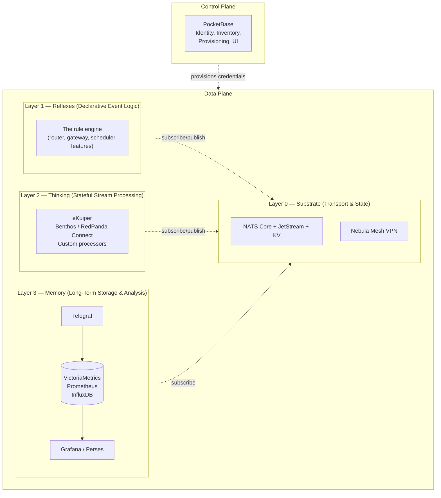
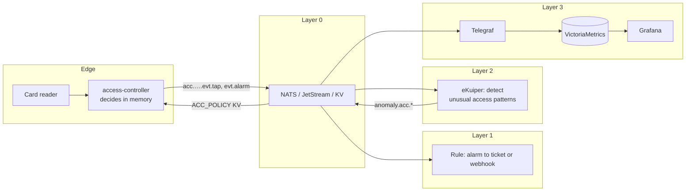

# Platform Layers

Stone-Age.io is a set of layers around one shared bus, NATS. Each layer does one
job. This page tells you which layer should solve a given problem.

---

## 1. Planes and Layers

> **Planes describe *what the platform does*. Layers describe *how the runtime is composed*.**

The **Control Plane** (PocketBase) manages identity, inventory and
credentials. The **Data Plane** (NATS, JetStream, KV, Nebula) carries all
telemetry, commands and live state. The Control Plane sits beside the Data
Plane, not in a layer: it provisions the identities the Data Plane uses. See
[Architecture §1](./architecture.md#1-control-plane-vs-data-plane) for the
split, and [Key Properties of This Topology](./architecture.md#key-properties-of-this-topology)
for what each plane does when the other restarts.

This page is about the Data Plane's **four layers** (0 to 3). Layer 0 is always
on. You add Layers 1 to 3 when you need them, and a Layer 3 outage does not
affect the layers below it.

---

## 2. The Four Layers

> **NATS is the bus. The rule engine is the reflexes. Stream processors are the thinking. Telegraf + TSDB is the memory.**

Every layer above 0 is optional. Layer 0 alone gives you messaging. Layers 0
and 1 cover most event-driven applications. All four give you full
observability. A higher layer does not change the layers below it.

---

## 3. Layer 0: Substrate

**Components:** NATS Core, JetStream, NATS KV, Nebula.

Layer 0 carries messages, durable streams, key-value state and the mesh network.

- **Messaging.** Pub/sub, request/reply and MQTT. Every other layer addresses
  data by NATS subject.
- **Durable state.** JetStream streams give at-least-once delivery. KV buckets
  hold live state (the digital twin, see [Architecture](./architecture.md)).
- **Connectivity.** The Nebula mesh connects edge sites peer to peer with
  outbound-only traffic.

**The Control Plane generates and feeds Layer 0 but is not part of it.** It
writes the NATS operator, accounts and server config, issues each
organization's Nebula CA, and pushes account changes to the running servers.
Other components never see it on the bus. See
[Architecture §2](./architecture.md#bootstrapping-the-nats-server-from-the-control-plane).

Many use cases need only Layer 0. To ingest telemetry and show it on a
dashboard, you need pub/sub, KV and the console reading NATS over WebSocket.

**You are at this layer when you:**

- Connect devices, services or users to the NATS bus.
- Configure Nebula groups and firewall rules.
- Write widgets that subscribe to NATS subjects.
- Set up JetStream streams and KV buckets.

---

## 4. Layer 1: Reflexes (Declarative Event Logic)

**Component:** the rule engine (`rule-router`), a separate binary with router,
gateway and scheduler features. It runs as its own process beside NATS.

Layer 1 holds rules: conditions and actions that run on each message, with no
state between messages.

**The rule engine handles:**

- **Trigger, condition, action.** "When a message on subject X matches
  condition Y, publish to subject Z or call a webhook."
- **Three trigger types.** NATS subjects (router), HTTP requests (gateway) and
  cron schedules (scheduler) use the same YAML syntax.
- **Routing and filtering.** Send a subset of events to another subject, reject
  bad messages, add metadata.
- **KV lookups.** Add context to an event from a KV bucket.
- **State in KV.** Alarm deduplication and presence tracking with a TTL. The
  rule has no state. The state is in KV. See [Automation](./automation.md).
- **Rate limiting and debounce.** A per-rule `throttle` block
  ([Automation](./automation.md#throttle-and-debounce-are-built-in)).
- **HTTP in and out.** The gateway turns webhooks into NATS messages. It also
  calls external APIs in response to NATS events, with retry.
- **Scheduled publishes.** The scheduler publishes to NATS or HTTP on a cron
  expression.

**Do not use the rule engine for** windowed aggregation, stream joins or
results that late data can change (that is Layer 2, see
[Stream Processing §1](./stream-processing.md#1-when-you-need-a-stream-processor)),
for multi-step workflows where each step decides the next, or for transactions:
the engine publishes, it does not coordinate commits.

**You are at this layer when you:**

- Write a YAML rule that says "when X happens, do Y".
- Use KV for state that rules read and write.
- Connect an external service by webhook, in either direction.
- Schedule publishes, such as reports, batch commands or periodic syncs.

---

## 5. Layer 2: Thinking (Stateful Stream Processing)

**Components:** eKuiper, Benthos / RedPanda Connect, Wombat, or any stream
processor that reads from and publishes to NATS.

Layer 2 does computation that needs state across events: sliding windows,
aggregations, joins and retraction of earlier results. It reads from and
publishes to the same NATS subjects as your Layer 1 rules, and the two share
nothing else.

When you need one, how it hands off to Layer 1, and which processor to pick:
[Stream Processing](./stream-processing.md).

---

## 6. Layer 3: Memory (Long-Term Storage & Analysis)

**Components:** Telegraf or similar, VictoriaMetrics / Prometheus / InfluxDB,
Grafana / Perses.

Layer 3 answers questions about the past.

**Layer 3 handles:**

- **Long-term retention.** Months to years of telemetry.
- **Trend queries.** "The 30-day moving average of CPU use across the warehouse
  sensors."
- **Historical alerts.** "Alert if this week's average is 10% higher than last
  week's."
- **Visualization** in Grafana or Perses.

Layer 3 only reads from NATS. Telegraf subscribes to telemetry and writes to a
TSDB. Grafana or Perses queries the TSDB.

A Layer 3 failure does not affect Layers 0 to 2. If VictoriaMetrics is down,
data still moves on NATS and live operation continues. Telegraf holds a limited
buffer in memory and writes it when the TSDB returns. A long outage leaves a gap
in your history. A plain subscription also misses what was published while
Telegraf itself was down. For history with no gaps, Telegraf must read through a
JetStream consumer. See
[Observability §3](./observability.md#3-data-flow-architecture).

**You are at this layer when:**

- The question starts with "what happened", not "what is happening".
- You build reports, dashboards or alerts over days, weeks or months.
- You need SQL or PromQL for historical analysis.
- You hand data to analysts, auditors or compliance tools.

Stone-Age.io does not bundle a TSDB. You pick the one that suits your operations
and budget. The subjects stay the same, so you can change from VictoriaMetrics
to InfluxDB, Postgres or Snowflake with no change to Layers 0 to 2. See
[Observability](./observability.md).

---

## 7. Which Layer Solves My Problem?

1. Moving bytes from A to B, or managing identity and inventory: Layer 0 or the
   Control Plane.
2. Logic you can say as "when X, check Y, do Z": Layer 1.
3. Short-lived state you can keep in KV: still Layer 1. Stateful alarms and
   presence tracking with a TTL fit here. Debounce and rate limiting use the
   rule engine's `throttle`.
4. Windows, stream joins or aggregation over time: Layer 2.
5. A question about the past: Layer 3.

Most applications use Layers 0, 1 and 3. Layer 2 comes in for analytical
behavior such as anomaly detection, cross-stream correlation and windowed
alerts.

Do not move a problem up a layer too early, for example a stream processor for
work the rule engine can do. Do not force it down either, for example windowed
logic in rules.

---

## 8. Reference Architecture — All Four Layers

This example uses all four layers. The domain is physical access control for an
organization with several sites, as the
[Access Control](./vendor/access-control/README.md) app does it.

**Layer 0** carries every message. The `ACC_POLICY` KV bucket holds users,
credentials, roles, access groups, portals and schedules. The `ACC_EVENTS`
stream stores what the controllers report.

**The decision is not in a layer.** A tap must open the door when the site's
link is down, so the edge controller decides it: a pure function over the
policy it mirrors from KV into memory. It then publishes the outcome on
`acc.{location}.{type}.{thing}.evt.tap`. A rule engine could make the same
decision from KV lookups, but only while it can reach the bus. This is the rule
of thumb for any application: logic that must keep working offline belongs in a
process at the edge, and the layers react to what it reports.

**Layer 1** reacts to events. A rule on `acc.*.*.*.evt.alarm` (door forced or
held open) can open a [Helpdesk](./vendor/helpdesk/README.md) ticket or call a
webhook.

**Layer 2** is optional and can come later. An eKuiper pipeline watches the tap
events and keeps a baseline for each user. It publishes an anomaly when someone
uses a door they rarely use, at an unusual hour or in an unusual order
([Stream Processing §6](./stream-processing.md#6-a-worked-example-anomaly-detection-on-access-events)).

**Layer 3** runs Telegraf on the `acc.>` events and the anomalies, writing to
VictoriaMetrics. Grafana shows access volume, deny reasons, use per door and
anomaly trends. vmalert can alert when the deny rate for a door rises sharply.

The layers share only NATS subjects. You can redeploy, scale or replace any one
of them without changes to the others.

---

## 9. Where to Go Next

- Control Plane and Data Plane: [Architecture](./architecture.md)
- Layer 0: [Connectivity](./connectivity.md), [Platform Entities](./platform-ui-entities.md), [The Console](./console.md)
- Layer 1: [Automation](./automation.md)
- Layer 2: [Stream Processing](./stream-processing.md)
- Layer 3: [Observability](./observability.md)
- The edge, all layers: [The Agent](./agent.md)
